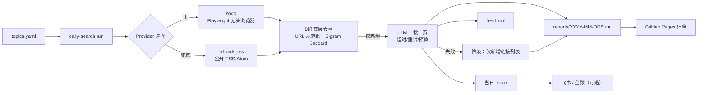

# 每日一搜 · 只推新增的中文话题追踪 Agent

给你订阅的中文话题，每天搜一次，**只推送比昨天新增/变化的内容**，每条结论都带原始链接，输出到 `reports/`、`feed.xml` 与当日 GitHub Issue，可选推送飞书/企业微信。

> 面向做竞品/舆情/政策跟踪的产品、运营、投研与开源维护者。现有 topic alert 产品（Octolens $199/月、Brand24 $249/月）几乎不覆盖中文生态，「只推新增」把每日噪音压成变化增量。

---

## 架构



模块依赖单向无环：`cli → config → providers → diff → agent → publish`。

```
src/daily_search/
├── config.py          # topics.yaml 四级 schema + fail fast
├── providers/         # base / soqq / fallback_rss / fixture / registry（熔断降级）
├── diff/              # normalize（URL+语义）/ snapshot（14 天）/ dedupe
├── agent/             # llm（超时·重试·预算）/ summarize（降级）
├── publish/           # markdown / feed / issue / im / pages / atomic
├── runner.py          # 编排（dry-run 只读）
├── comment_agent.py   # /deep /mute /why
├── subscribe.py       # 订阅 Issue → topics.yaml 变更
├── spike.py           # so.qq.com 可行性探测
└── cli.py
```

---

## 快速开始（本地）

```bash
python -m venv .venv && . .venv/bin/activate
pip install -e ".[dev]"

# 1) 无任何 Secret：验证降级路径（只输出，不落盘）
python -m daily_search run --dry-run --no-issue

# 2) 完全离线：用 fixture 生成一天的报告
python -m daily_search run --date 2026-11-11 --fixture fixtures/search-2026-11-11.json --no-issue

# 3) 测试
pytest -q
```

真实抓取 so.qq.com 需要 Playwright：

```bash
pip install -e ".[browser]"
python -m playwright install --with-deps chromium
python -m daily_search spike --json     # 先探测可达性/风控
python -m daily_search run             # 需要 LLM_* 与 GITHUB_TOKEN 才写 Issue
```

CLI 子命令：`run` / `spike` / `subscribe` / `comment` / `notify` / `pages`。

---

## Secrets 配置

全部通过仓库 **Settings → Secrets and variables → Actions** 注入，代码与日志不落明文（`logging_utils.RedactionFilter` 统一脱敏，单测断言）。

| Secret | 必填 | 用途 |
| --- | --- | --- |
| `LLM_BASE_URL` | 可选 | OpenAI 兼容接口地址（如 `https://host/v1`） |
| `LLM_API_KEY` | 可选 | LLM 凭据；缺失 → 自动降级为「仅新增链接列表」 |
| `LLM_MODEL` | 可选 | 模型名（默认 `antigravity/gemini-3.8-flash`） |
| `FEISHU_WEBHOOK_URL` | 可选 | 飞书机器人 webhook；缺失 → 跳过该渠道并 warn |
| `WECOM_WEBHOOK_URL` | 可选 | 企业微信机器人 webhook；缺失 → 跳过 |
| `GITHUB_TOKEN` | 内置 | workflow 自带；用于建 Issue、提交报告、开订阅 PR |

`GITHUB_TOKEN` 由 Actions 自动注入（`permissions: contents: write / issues: write`），无需手工配置。
工作流不会向 `fork` 来的 PR 注入任何 Secret（`ci.yml` 只用只读权限）。

---

## 工作流

| 文件 | 触发 | 作用 |
| --- | --- | --- |
| `daily-search.yml` | cron `0 0 * * *`（北京时间 08:00）+ 手动 | 抓取 → 去重 → 摘要 → 写报告/feed → 建当日 Issue → 提交报告 |
| `subscribe-from-issue.yml` | Issue 打开/编辑（含「话题名称」段落）+ 手动 | 校验订阅字段 → 改 `topics.yaml` → 开 PR |
| `issue-comment-agent.yml` | Issue 评论 `/deep` `/mute` `/why` + 手动 | 权限校验（OWNER/MEMBER/COLLABORATOR）→ 执行 → 回帖 |
| `notify.yml` | `daily-search` 成功后 + 手动 | 把当日 `index.md` 摘要推送到飞书/企微 |
| `pages.yml` | `reports/**`、`feed.xml` 变更 + 手动 | 生成静态归档并部署 GitHub Pages |
| `ci.yml` | push/PR + 手动 | `pytest` + `compileall` |

### ⚠️ 首次启用：把 workflow 放到 `.github/workflows/`

当前 6 个 workflow 文件位于 **`.github/workflows.pending/`**。把它们移入标准目录后才由 GitHub Actions 识别：

```bash
git mv .github/workflows.pending/*.yml .github/workflows/
git commit -m "ci: 启用 Actions workflows" && git push
```

原因：写入 `.github/workflows/*` 需要 **`workflow` scope** 的凭据，而当前用于推送的凭据只有 `repo` 权限（GitHub 报 `refusing to allow a Personal Access Token to create or update workflow ... without workflow scope`）。为不让整条分支推送失败，workflow 文件先落在可推送的目录，内容与最终版本一致（`tests/test_workflows.py` 校验 YAML 合法、均含 `workflow_dispatch`、权限最小化、无明文凭据）。

---

## 去重怎么做到「只推新增」

1. **URL 层**：去 `utm_*/spm/ref/from` 等追踪参数、host 小写去 `www`、`http→https`、去尾斜杠与 fragment、query 排序 → `sha256` 指纹。
2. **语义层**：标题 + 摘要做 NFKC 归一化、去标点空白，取字符 3-gram，Jaccard ≥ `semantic_threshold`（默认 0.85）判为同一事件——覆盖「换域名/换链接但内容相同」。
3. **快照**：`data/<slug>/latest.json` 存 `url_hash / norm_hash / first_seen / last_seen`，保留 14 天（`snapshot_retention_days`）。
4. **统计**：报告头与 Issue 都给出 `新增 / 候选 / 重复率`；`tests/test_dedupe.py` 用固定双日 fixture 断言第二天重复率 < 10%。

快照损坏/缺失时按「无历史」处理并告警，不阻断当天产出。

---

## so.qq.com 可行性 spike 结论

**实测（2026-11-12，本工作区服务器网络）**

| 项 | 结果 |
| --- | --- |
| `GET https://so.qq.com/` | HTTP 200，86,661 bytes |
| 验证码/风控页 | 未命中 |
| 首字节耗时 | 442 ms |
| 页面形态 | 含 `<script>` 的 SPA 外壳，正文需 JS 渲染 |

**结论**

1. 网络层可达，但**结果页必须由浏览器渲染**——所以 provider 用 Playwright（`chromium` headless、45s 超时、重试 1 次），而不是 `requests` 抓 HTML。
2. 该探测只证明「服务器网络可达」，**不能代表 GitHub 海外 runner 可达**。首次启用后请在 Actions 手动跑一次 `daily-search.yml` 并勾选 `spike=true`，把结果补进本节；若海外 runner 被风控/验证码拦截，按下面兜底：
   - 自动兜底：连续 2 次 `ProviderBlocked` → 本次运行全量切 `fallback_rss`（无需人工）；
   - 长期方案：改用 self-hosted runner（中国大陆节点），或把 `provider_order` 改为 `[fallback_rss, soqq]`；
   - `pages.yml` / Issue 发布不依赖 so.qq.com，兜底期间产出不中断。
3. 合规：低频访问（每话题 ≤ 3 次/天）、只存摘要与链接、不全文转载、不绕过验证码。

---

## 验收标准对照

| 验收项 | 落点 |
| --- | --- |
| 手动触发产出当日报告与 Issue | `daily-search.yml`（`workflow_dispatch`）+ `publish/issue.py` |
| 连续两天只出现新增，重复率 < 10% | `diff/dedupe.py` + `tests/test_dedupe.py::test_two_day_fixture_repeat_rate_below_ten_percent` |
| 每条结论带可点击原始链接 | `publish/markdown.py`、`publish/issue.py`（`[标题](url)`）+ 测试断言 |
| 仓库与日志无明文 key | `logging_utils.RedactionFilter` + `tests/test_redaction.py` + `tests/test_workflows.py` |
| 无 Secret 也能产出（降级） | `agent/summarize.py` + `run --dry-run` |
| 6 个 workflow 含 `workflow_dispatch` | `.github/workflows.pending/` + `tests/test_workflows.py`（启用步骤见上） |

---

## 目录约定

- `topics.yaml`：话题订阅源（`topic / keywords + exclude / subscribers / channels`）
- `data/<slug>/latest.json`：去重快照（自动维护，勿手改）
- `reports/YYYY-MM-DD/<slug>.md`：每日每话题一页；`index.md` 为当日汇总
- `feed.xml`：RSS 2.0，按「话题 × 日期」一条，保留最近 60 条
- `fixtures/`：离线样例数据，供 `--fixture` 与测试使用
- `skill/SKILL.md`：把「每日一搜」复用到其它 Agent 的 Skill 说明

## 安全

- 凭据只从 env/Secrets 读取；`LLM_API_KEY`/`*_TOKEN`/`*_WEBHOOK_URL` 及 `sk-`、`ghp_`、`github_pat_`、Bearer 形态的值在日志与异常栈中会被替换为 `[REDACTED]`。
- 报告、Issue、feed 落盘前再过一次 `redact_text`。
- `issue-comment-agent` 只接受 `OWNER`/`MEMBER`/`COLLABORATOR` 的指令。
- `ci.yml` 不用 `pull_request_target`，fork PR 拿不到任何 Secret。